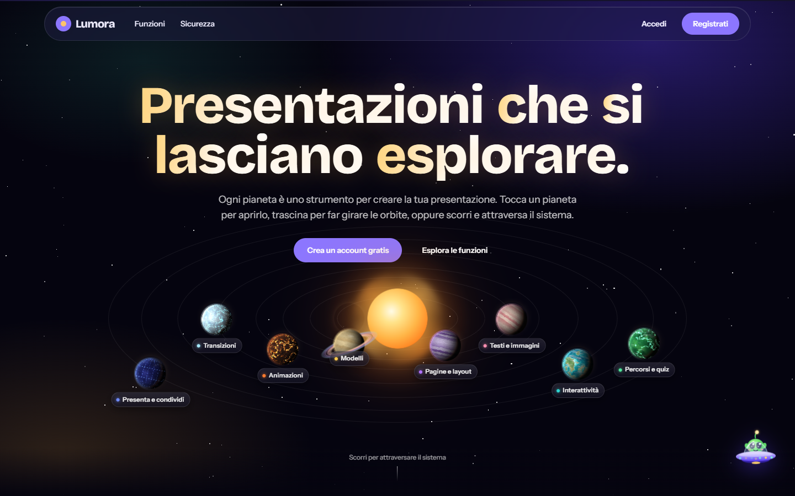
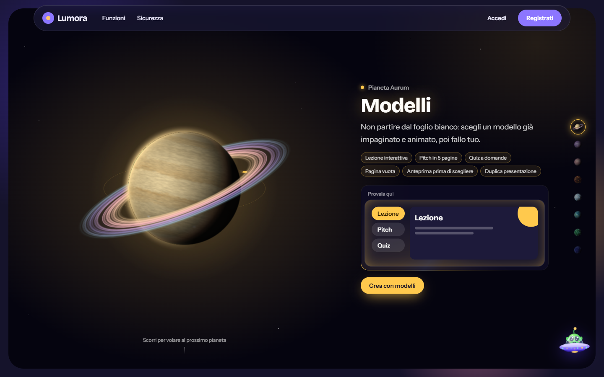
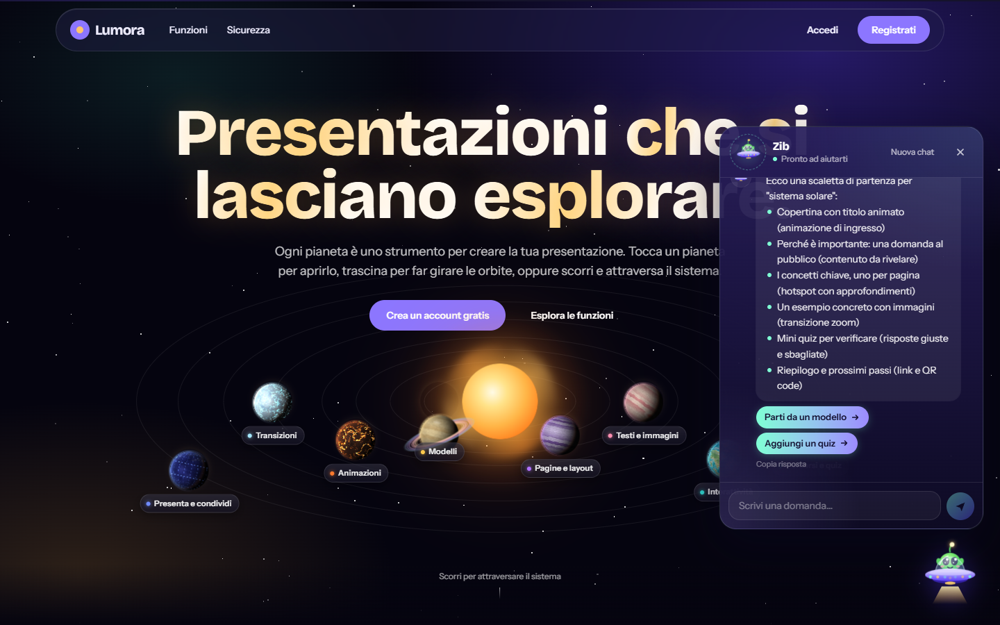
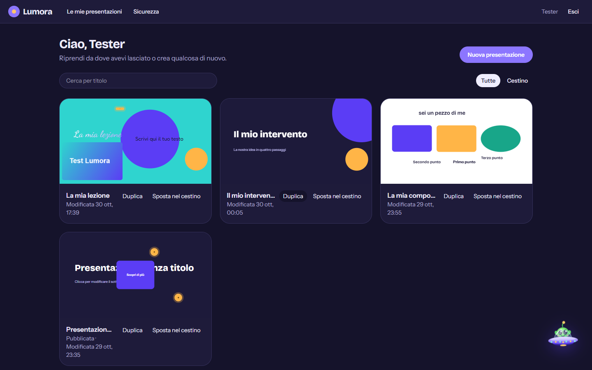
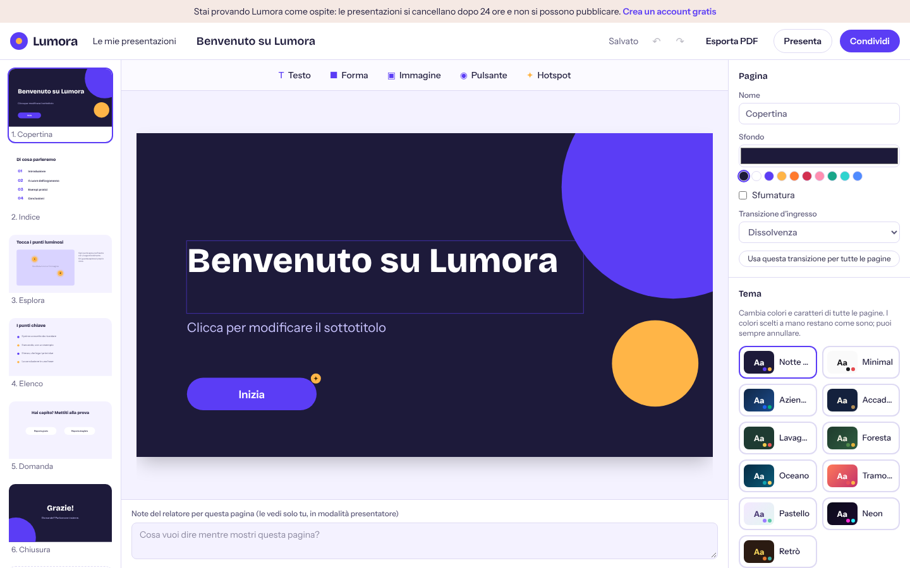
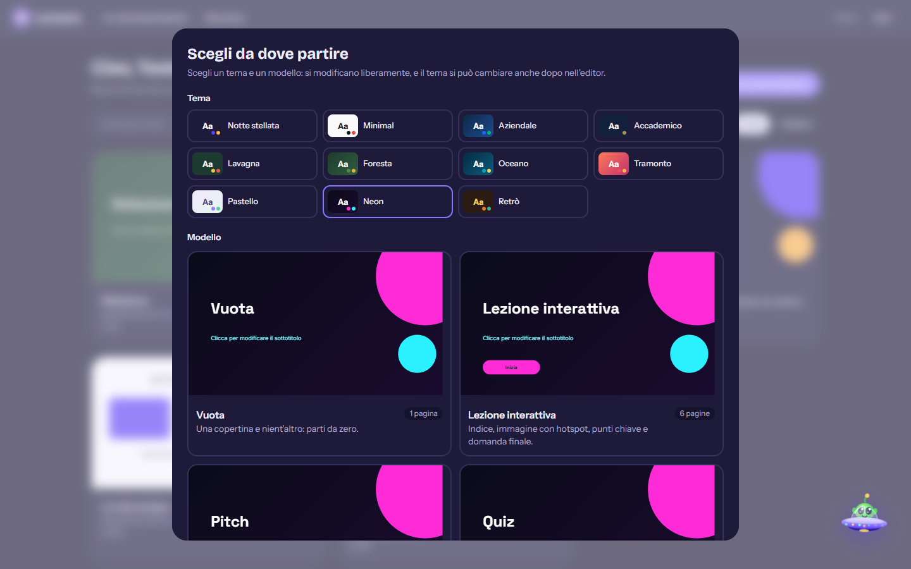
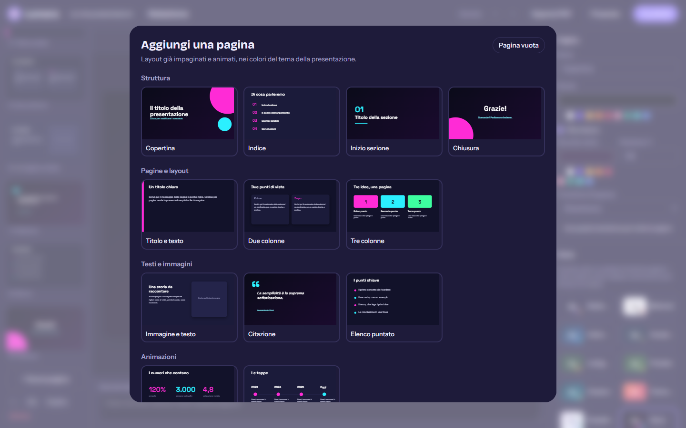

# Lumora

**Presentazioni che si lasciano esplorare.** Lumora è una piattaforma web per creare presentazioni interattive (hotspot, quiz, percorsi a bivi, animazioni e transizioni), progettata con la sicurezza come requisito di partenza.



## Cosa fa

- **Temi e layout**: 11 temi grafici coordinati (colori e caratteri), 8 modelli di presentazione e 17 layout di pagina già impaginati e animati; il tema si cambia in un clic su tutta la presentazione.
- **Editor visuale** a tre colonne: pagine, tela e pannello delle proprietà, con 32 font, colori pieni o sfumature, ombre, contorni, livelli, allineamenti, annulla/ripeti e scorciatoie da tastiera.
- **Interattività**: hotspot luminosi, finestre di approfondimento, contenuti da rivelare, pulsanti che portano ad altre pagine (quiz e storie a bivi), link esterni con conferma.
- **Animazioni e transizioni**: 7 effetti di ingresso, 4 continui, dissolvenza, scorrimento, zoom e rotazione 3D tra le pagine. Rispettano `prefers-reduced-motion`.
- **Presenta e condividi**: modalità presentatore con note e cronometro, avanzamento automatico, esportazione in PDF, link pubblico con password facoltativa, QR code e codice per incorporare.
- **Homepage come prodotto**: un sistema solare interattivo in cui ogni pianeta è una funzione. I pianeti sono renderizzati pixel per pixel su canvas da texture procedurali generate in Web Worker; i giganti gassosi sono modellati su Giove e Saturno (fasce irregolari, vortici, grande tempesta, oscuramento al bordo).
- **Zib, l'assistente**: un alieno nella sua navicella che risponde in streaming tramite Claude e, su richiesta ("fammi una presentazione sulla fotosintesi"), sceglie modello e tema, propone la scaletta e crea la presentazione dopo un'anteprima. Senza chiave API usa un motore integrato che capisce domande senza accenti e con refusi, risponde a più argomenti insieme, segue il filo della conversazione e suggerisce le domande successive.

| Viaggio tra le funzioni | Assistente Zib |
| --- | --- |
|  |  |

| Dashboard | Editor |
| --- | --- |
|  |  |

| Temi e modelli | Layout di pagina |
| --- | --- |
|  |  |

## Sicurezza

La sicurezza è stata progettata sul modello OWASP Top 10 e verificata con un test di penetrazione in locale (accesso non autorizzato, CSRF, iniezioni, IDOR, upload malevoli, forza bruta, enumerazione degli utenti, fughe di informazioni).

| Area | Come è protetta |
| --- | --- |
| Password | argon2id con limite di concorrenza; rifiuto delle password comparse in violazioni note (Have I Been Pwned, k-anonymity) |
| Accesso | blocco dopo 10 tentativi, limiti per IP e per email, stesso messaggio e stessi tempi per account esistenti e inesistenti |
| Due fattori | TOTP con protezione dal riutilizzo dei codici, codici di recupero salvati come HMAC |
| Sessioni | token opachi salvati solo come hash SHA-256, cookie `__Host-` HttpOnly, Secure, SameSite, rotazione al cambio password |
| Dati sensibili | segreti TOTP cifrati con AES-256-GCM, chiavi derivate con HKDF |
| CSRF | verifica dell'Origin su ogni richiesta che modifica dati, metodi HTTP non previsti rifiutati |
| XSS e framing | Content Security Policy con nonce e `strict-dynamic`, nessun HTML non controllato, framing consentito solo alla pagina di incorporamento |
| Autorizzazione | ogni lettura e scrittura filtrata per proprietario: le risorse altrui rispondono 404 |
| Upload | tipo verificato dai byte del file (non dall'estensione), immagini servite con `nosniff` e CSP `sandbox` |
| Abusi | limiti di frequenza su login, salvataggi, pubblicazioni, upload e assistente; quote di spazio per utente |
| Contenuti | ogni documento validato con schema Zod; solo link `https` |

Dettagli e segnalazione di vulnerabilità in [SECURITY.md](SECURITY.md).

## Tecnologie

- **Next.js 16** (App Router, Server Actions, proxy per CSP e CSRF), **React 19**, **TypeScript**
- **Tailwind CSS 4** e **Motion** per animazioni e interazioni
- **PostgreSQL** con **Prisma 7**
- **Canvas 2D + Web Worker** per i pianeti procedurali
- **Claude API** (`@anthropic-ai/sdk`) per l'assistente, con risposte in streaming
- **Vitest** per i test, **ESLint**, **GitHub Actions** con CodeQL e Dependabot

## Avvio in locale

Servono Node.js 22 o superiore e PostgreSQL.

```bash
git clone https://github.com/rosariosapienza12/lumora.git
cd lumora
npm install
cp .env.example .env   # poi compila DATABASE_URL ed ENCRYPTION_KEY
npx prisma migrate deploy
npm run dev
```

Il sito è su http://localhost:3000. Per generare `ENCRYPTION_KEY`:

```bash
node -e "console.log(require('crypto').randomBytes(32).toString('base64'))"
```

`ANTHROPIC_API_KEY` è facoltativa: senza, Zib risponde con la guida integrata.

## Script

| Comando | Cosa fa |
| --- | --- |
| `npm run dev` | server di sviluppo |
| `npm run build` | build di produzione |
| `npm start` | avvia la build di produzione |
| `npm test` | test unitari |
| `npm run lint` | controllo del codice |
| `npm run typecheck` | controllo dei tipi |

## Struttura

```
src/
  app/            pagine e route (marketing, auth, dashboard, editor, condivisione, API)
  components/     pianeti, player, assistente, elementi delle slide
  lib/            autenticazione, crittografia, validazione, rate limit, editor
  proxy.ts        Content Security Policy con nonce e controllo CSRF
prisma/           schema e migrazioni del database
```

## Autore

**Rosario Sapienza**: progettazione, sviluppo e test di sicurezza.

Distribuito con licenza [MIT](LICENSE).
