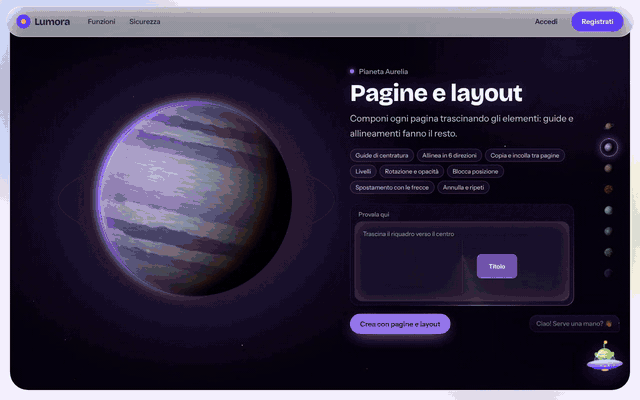
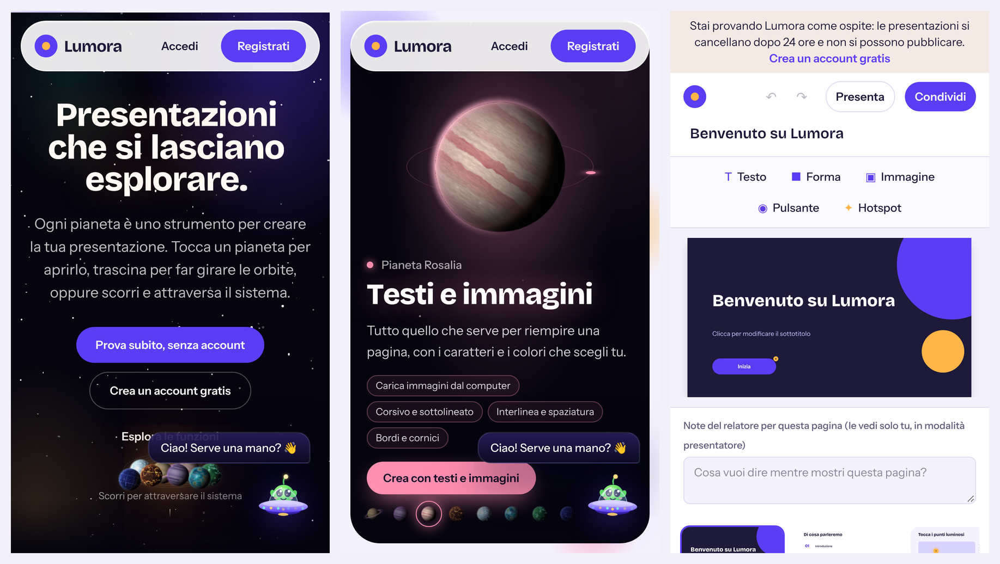

# Lumora

**Presentations people can explore.** Lumora is a web platform for building interactive presentations (hotspots, quizzes, branching paths, animations and transitions), designed with security as a requirement from day one.

> The app's interface is in Italian.

**Live demo: [lumora-rosario.vercel.app](https://lumora-rosario.vercel.app)**. Press "Prova subito, senza account" to open the editor without signing up.




## Features

- **Try it without an account**: "Prova subito" opens the editor on an example presentation for a temporary guest. Guests cannot publish and are deleted, with everything they made, after 24 hours.
- **Themes and layouts**: 19 coordinated visual themes (colors and fonts), 8 presentation templates and 25 ready-made, animated page layouts on a shared grid: full-bleed photo, photo mosaic, arrow process, concept map, VS comparison, percentage ring, icon grid, pyramid, timeline and more. Switching theme restyles the whole presentation in one click.
- **Topic decorations**: 14 topics (environment, technology, space, sea, science, history, art, music, business, school, sport, food, travel, health), each with its own theme and illustrations placed in the page margins (leaves and buildings, chips and circuits…). A placement algorithm only uses free margin spots, so decorations never cover text, photos or buttons; they are locked, restyle with the theme and are swapped when the topic changes.
- **Free photos on request**: "Find free photos" in the editor searches Wikimedia Commons through an authenticated, rate-limited endpoint (`/api/immagini`); only freely licensed JPEG/PNG/WebP files from Wikimedia hosts are accepted, and each photo carries its author and licence on the slide. Layout photo spaces receive real photos in place, keeping size and animation.
- **Generate from a topic**: "New presentation → From a topic" (and Zib) picks the topic, theme and a varied set of layouts; with "with images" it also fills the photo spaces with free photos. Outlines travel in a compact, strictly validated format: `Title|theme|layout=Heading;…|topic|foto=search words`.
- **Visual editor** with three columns (pages, canvas and properties panel): 28 shapes (stars, arrows, hearts, speech bubbles, leaves, clouds and more), a handle to rotate any element through 360° plus mirroring, 32 fonts, solid colors or gradients, shadows, outlines, layers, alignment, undo/redo and keyboard shortcuts.
- **Interactivity**: glowing hotspots, pop-up details, content to reveal, buttons that jump to other pages (quizzes and branching stories), external links with confirmation.
- **Animations and transitions**: 7 entrance effects, 4 looping effects, and fade, slide, zoom and 3D-rotate transitions between pages. All of them respect `prefers-reduced-motion`.
- **Present and share**: presenter mode with notes and timer, auto-advance, PDF export, public link with optional password, QR code and embed code.
- **The homepage is a product in itself**: an interactive solar system where every planet is a feature. The planets are rendered pixel by pixel on a canvas from procedural textures generated in Web Workers; the gas giants are modeled on Jupiter and Saturn (irregular bands, vortices, a great storm, limb darkening). Between stops a small show plays around the planet (a shooting star, a meteor shower, an alien ship circling it, a comet, a satellite); one wheel or swipe gesture moves exactly one planet, and on phones the tour drops the costly effects to stay smooth.
- **Zib, the assistant**: an alien in its spaceship (drag it anywhere on screen) that answers in real time (streaming) through Claude. On request ("make me a presentation about photosynthesis", optionally "with images") it picks the topic, theme and layouts, proposes an outline and creates the presentation after a preview. Without an API key it falls back to a built-in engine that understands questions without accents and with typos, answers several topics at once, follows the conversation and suggests follow-up questions.

| Tour of the features | Zib assistant |
| --- | --- |
|  |  |

| Dashboard | Editor |
| --- | --- |
|  |  |

| Themes and templates | Page layouts |
| --- | --- |
|  |  |

On phones: the homepage, the planet tour and the editor, which stacks into one column.



## Security

Security was designed around the OWASP Top 10 and checked with a local penetration test (unauthorized access, CSRF, injection, IDOR, malicious uploads, brute force, user enumeration, information leaks).

| Area | How it is protected |
| --- | --- |
| Passwords | argon2id with a concurrency limit; passwords found in known breaches are rejected (Have I Been Pwned, k-anonymity) |
| Login | lockout after 10 attempts, limits per IP and per email, same message and same timing for existing and non-existing accounts |
| Two-factor | TOTP with protection against code reuse, recovery codes stored as HMAC |
| Sessions | opaque tokens stored only as SHA-256 hashes, `__Host-` cookie that is HttpOnly, Secure and SameSite, rotation on password change |
| Sensitive data | TOTP secrets encrypted with AES-256-GCM, keys derived with HKDF |
| CSRF | Origin check on every request that changes data, unexpected HTTP methods rejected |
| XSS and framing | Content Security Policy with nonce and `strict-dynamic`, no unchecked HTML, framing allowed only on the embed page |
| Authorization | every read and write is filtered by owner: other users' resources return 404 |
| Uploads | file type checked from the file's bytes (not the extension), images served with `nosniff` and a `sandbox` CSP |
| Abuse | rate limits on login, saves, publishing, uploads and the assistant; per-user storage quotas |
| Content | every document validated with a Zod schema; `https` links only |
| Privacy | self-service account deletion (password and explicit confirmation, cascade delete of presentations, images and sessions); privacy, terms and cookie pages; only technical cookies |

These rules are checked by automated tests on a real PostgreSQL database
([`src/lib/security.int.test.ts`](src/lib/security.int.test.ts), run in CI on every push):
no access to another user's presentations, no private, deleted or note-revealing public pages,
single-use email tokens stored as hashes, rate limits, and complete deletion of accounts and
expired guests. Each test was checked to fail when its rule is removed.

Details and vulnerability reporting in [SECURITY.md](SECURITY.md).

## Tech stack

- **Next.js 16** (App Router, Server Actions, proxy for CSP and CSRF), **React 19**, **TypeScript**
- **Tailwind CSS 4** and **Motion** for animations and interactions
- **PostgreSQL** with **Prisma 7**
- **Canvas 2D + Web Workers** for the procedural planets
- **Claude API** (`@anthropic-ai/sdk`) for the assistant, with streaming responses
- **Vitest** for tests, **ESLint**, **GitHub Actions** with CodeQL and Dependabot

## Running locally

You need Node.js 22 or later and PostgreSQL.

```bash
git clone https://github.com/rosariosapienza12/lumora.git
cd lumora
npm install
cp .env.example .env   # then fill in DATABASE_URL and ENCRYPTION_KEY
npx prisma migrate deploy
npm run dev
```

The site runs at http://localhost:3000. To generate `ENCRYPTION_KEY`:

```bash
node -e "console.log(require('crypto').randomBytes(32).toString('base64'))"
```

`ANTHROPIC_API_KEY` is optional: without it, Zib answers using the built-in guide.

## Deploying for free (Vercel + Neon)

1. **Database:** create a free project on [Neon](https://neon.tech) and copy the
   connection string with connection pooling switched off (migrations need a direct
   connection).
2. **App:** on [Vercel](https://vercel.com) choose **Add New → Project**, import this
   repository and add these environment variables:

   | Variable | Value |
   | --- | --- |
   | `DATABASE_URL` | the Neon connection string |
   | `ENCRYPTION_KEY` | 32 random bytes in base64 (command above) |
   | `APP_URL` | the site address, e.g. `https://lumora.vercel.app` |

3. **Deploy.** Vercel runs the `vercel-build` script, which applies the database
   migrations and then builds the app. `vercel.json` runs the server code in
   Frankfurt (`fra1`), next to a Neon database in Frankfurt: every page makes
   several database queries, and a server on another continent would add a
   round trip across the ocean to each one. Pick the region of your database.

Optional extras:
- `RESEND_API_KEY` and `MAIL_FROM` (a domain verified on [Resend](https://resend.com))
  to send confirmation and password-reset emails. Without them, people can still sign
  up, sign in, use the editor and try Lumora as a guest, but publishing needs a
  confirmed email.
- `ANTHROPIC_API_KEY` for Zib's AI answers. Without it, Zib uses its built-in guide.
- `CONTACT_EMAIL`: the address shown on the privacy and terms pages for data requests.

`TRUSTED_PROXY_HOPS` stays `0` on Vercel, which replaces `X-Forwarded-For` with the
real client address.

## Scripts

| Command | What it does |
| --- | --- |
| `npm run dev` | development server |
| `npm run build` | production build |
| `npm run vercel-build` | database migrations + production build (used by Vercel) |
| `npm start` | starts the production build |
| `npm test` | unit tests; with `DATABASE_TESTS=1` also the security tests on a real PostgreSQL |
| `npm run lint` | code linting |
| `npm run typecheck` | type checking |

## Project structure

```
src/
  app/            pages and routes (marketing, auth, dashboard, editor, sharing, API)
  components/     planets, player, assistant, slide elements
  lib/            authentication, cryptography, validation, rate limiting, editor
  proxy.ts        Content Security Policy with nonce and CSRF check
prisma/           database schema and migrations
```

## Author

**Rosario Sapienza**: design, development and security testing.

Released under the [MIT](LICENSE) license.
